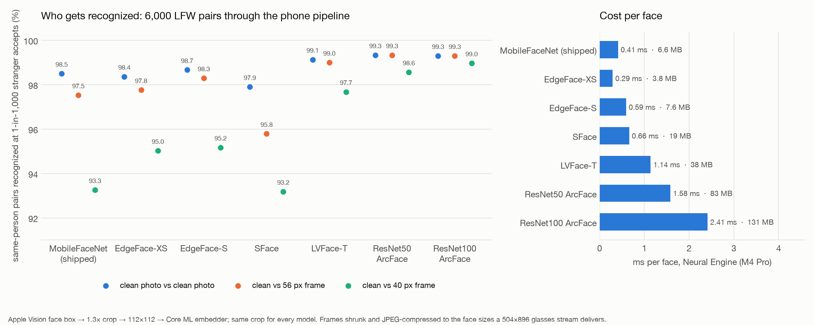

# Face embedder evaluation

Which face-embedding model should the glasses run, and is the one we ship using the Neural Engine?
This directory answers both with measurements instead of paper numbers. Results: [`RESULTS.md`](RESULTS.md).
Candidate conversion notes: [`extra/MODELS.md`](extra/MODELS.md).

## Takeaways (Oct 24, 2026)



The headline chart is threshold-free: the share of same-person pairs recognized when each model's
threshold is set so that one stranger in a thousand would be accepted. `results_phone_threshold.png`
is the same data at the fixed 0.50 the phone uses today; it shows the bug, not the models' quality,
because a model whose scores all run higher (EdgeFace, SFace) looks better at 0.50 without
separating people any better.

1. **The misses are mostly the threshold, not the model.** The phone accepts a match at cosine 0.50,
   a number carried over from InsightFace's landmark-aligned pipeline. Through our Vision box crop,
   same-person scores sit lower: with the shipped MobileFaceNet only 77% of same-person LFW pairs
   clear 0.50 on clean photos, 60% at a 56 px face, and 30% at a 40 px face. Different-person pairs
   never exceed 0.30 on clean photos (0 of 3,000) and reach 0.30 in 0.00% of comparisons at 40 px.
   Moving the threshold to **0.30** takes the shipped model to 98.0% / 95.8% / 88.3% same-person
   acceptance (clean / 56 px / 40 px) with no stranger accepted in 9,000 comparisons.
2. **ResNet50 ArcFace is the drop-in upgrade.** Same input contract and conversion script, 83 MB,
   1.6 ms per face pinned to the Neural Engine (2.8 ms in the run with everything sharing it). At
   threshold 0.30 it accepts 99.0% / 98.9% / 96.6% of same-person pairs with zero stranger accepts, and
   its TAR at 0.1% FAR on 40 px faces is 98.6% versus 93.3% for the shipped model. ResNet100 adds
   about a point at 40 px (97.7% at 0.30) for 131 MB and 2.4 ms. Both are InsightFace weights,
   non-commercial research use, same as what ships today.
3. **If the license has to be permissive,** EdgeFace-S (BSD-3-Clause, 7.6 MB, 0.6 ms) is the pick,
   but its scores run hotter: at 0.30 it accepts 0.3 to 0.4% of strangers per comparison, so it wants
   its own threshold near **0.40** (98.3% / 97.6% / 94.0% same-person, zero strangers). SFace
   (Apache-2.0) is the weakest discriminator here (TAR at 0.1% FAR 93.2% at 40 px) and is 128-d.
4. **The Neural Engine is already in use.** Apple's `MLComputePlan` reports every compute op of the
   shipped model on the Neural Engine (the three CPU ops are the pixel scale/bias). Embedding is
   0.4 ms per face; Vision detection (4.7 ms here) and the HEVC decode dominate the frame budget, so a
   bigger embedder costs almost nothing. Gotcha: with `computeUnits = .all`, Core ML's placement
   prefers the **GPU** for EdgeFace and LVFace (5 ms instead of 0.3 to 1.1 ms); pin those to
   `.cpuAndNeuralEngine`.
5. **Below 36 px nothing helps.** 9.75% of the 40 px tier is skipped by the size gate, identical for
   every model. The only fixes are optical: the `.high` 720x1280 stream preset (faces 1.43x larger)
   or asking the wearer to get closer.

Caveats: this is LFW (mostly frontal, mostly well lit, celebrities), degraded synthetically; the demo
room has motion blur and side lighting that LFW does not. Numbers are from an M4 Pro, not the iPhone,
though the Neural Engine ordering holds. A Vision-only crop is used for every model, including the
ones trained on landmark-aligned faces; alignment would raise all scores and likely the margins.

## What is measured

The phone pipeline, reproduced on a Mac with the same Apple frameworks:

1. Apple Vision `VNDetectFaceRectanglesRequest` finds the largest face.
2. The crop is the one in `FaceRecognizer.swift`: a square 1.3x the box, shifted up 0.2 box heights,
   resized to 112x112. No landmark alignment, exactly like the phone.
3. Faces narrower than 36 px are skipped (`FaceRecognizer.minFaceSide`), exactly like the phone.
4. Each Core ML embedder runs on the same crop with `computeUnits = .all`; embeddings are L2-normalized
   and compared by dot product, the way `LocalRecognition.match` does.

Running all models on one crop means the accuracy differences are the models', not the detector's.

## Dataset and protocols

[LFW](http://vis-www.cs.umass.edu/lfw/) (deep-funneled release, 13,233 images, 5,749 people) with the
official 10-fold verification protocol: 6,000 pairs, 3,000 same-person and 3,000 different-person,
in 10 folds of 600. Files come from the figshare mirrors scikit-learn uses, with checksums.

LFW is close to saturated for modern models, so two extra protocols imitate the demo. The first image
of each pair stays clean (the enrollment photo in the roster). The second is shrunk and recompressed to
look like a face in a 504x896 glasses frame sent over Bluetooth Classic:

| Protocol | Vision face box width | JPEG quality | Roughly |
|---|---|---|---|
| clean | 113 px (median) | original | the standard LFW benchmark |
| face56 | 56 px | 50 | someone about 1.5 m away |
| face40 | 40 px | 40 | someone about 2.5 m away, just above the 36 px cutoff |

The size calibration is empirical: Vision's box on clean LFW is a median 113 px wide, and the resize
is linear. `prepare_lfw.py` makes the tiers; `FaceEval.swift` records every face width so the calibration
can be checked in `out/full/meta.json`.

## Metrics

- **10-fold accuracy**: the number papers report for LFW. Threshold chosen on 9 folds, tested on the
  10th, averaged. Only pairs where both faces were detected count.
- **TAR @ 1% / 0.1% FAR**: true-accept rate when the threshold is set so that 1% (0.1%) of
  different-person pairs are wrongly accepted. Less saturated than accuracy.
- **acc @ 0.50**: accuracy at the threshold the phone actually uses (`LocalRecognition.matchThreshold`).
  This is the number that explains the misses we saw.
- **end-to-end @ 0.50**: like acc @ 0.50, but a pair whose face was not detected or was too small is a
  non-match. For a same-person pair that is an error, which is what the wearer experiences.
- **same mean / p10, diff mean / p99**: where the score distributions sit. p10 of same-person scores
  is the one in ten genuine encounters that scores lowest; p99 of different-person scores is the
  one in a hundred strangers that scores highest. A threshold has to fit between them.
- **best thr**: the mean of the per-fold optimal thresholds.

Speed is the median Core ML prediction time per face on this Mac's Neural Engine (M4 Pro); the iPhone's
ANE is slower but the ordering holds. `ComputePlan.swift` prints the per-operation device placement
(Apple's `MLComputePlan` API) so "runs on the Neural Engine" is verified, not assumed.

## Models

See `models.json` for sources and licenses. InsightFace recognizers are converted with `convert_onnx.py`;
EdgeFace, SFace and LVFace have their own scripts under `extra/` because each needed a different
export path (documented in `extra/MODELS.md`).

| key | model | params | compiled | license |
|---|---|---|---|---|
| mbf | MobileFaceNet, InsightFace buffalo_sc (shipped) | 1.0 M | 6.6 MB | non-commercial research |
| edgeface_xs | EdgeFace-XS γ0.6 | 1.8 M | 3.8 MB | BSD-3-Clause |
| edgeface_s | EdgeFace-S γ0.5 | 3.7 M | 7.6 MB | BSD-3-Clause |
| sface | SFace (OpenCV Zoo, 128-d) | 9.6 M | 19 MB | Apache-2.0 |
| lvface_t | LVFace-T (ViT, Glint360K) | 19.1 M | 38 MB | weights non-commercial |
| r50 | ResNet50 ArcFace, InsightFace buffalo_l | 43.6 M | 83 MB | non-commercial research |
| r100 | ResNet100 ArcFace, InsightFace antelopev2 | 65 M | 131 MB | non-commercial research |

## Reproduce

```sh
./run.sh            # venv, LFW download (~230 MB), InsightFace conversions, eval, RESULTS.md, ANE placement
```

About 15 minutes on an M-series Mac; the evaluation itself is ~9 minutes for 16,853 images with seven
models. Needs Xcode (Vision, Core ML, `coremlcompiler`) and `uv`. The extra candidates are converted
with the scripts in `extra/` into `models/<key>/FaceEmbedder.mlmodelc`; `run.sh` picks them up if present.

Datasets, converted models and raw embeddings are gitignored; only code and `RESULTS.md` are tracked.
